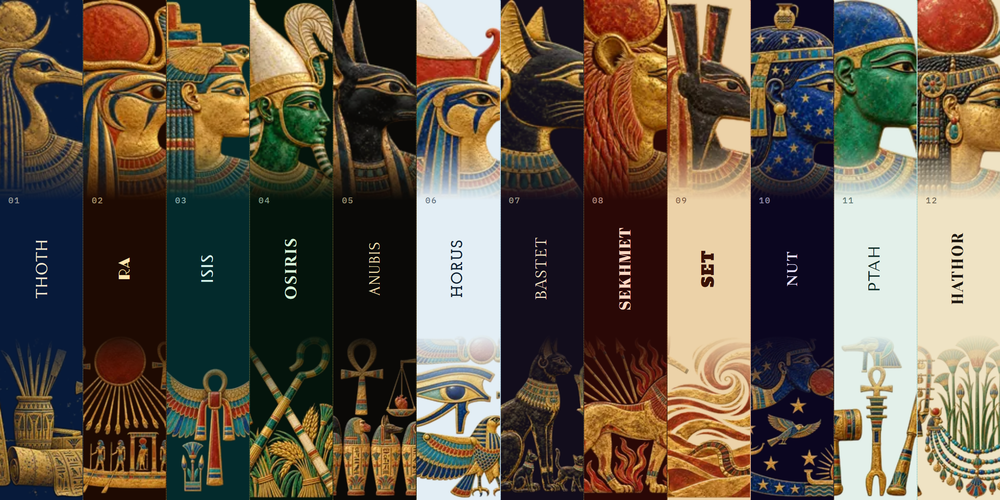

<div align="center">

  <a href="https://github.com/NousResearch/hermes-agent">
    
  </a>

  # Ennead

  **Twelve Egyptian gods for your Hermes desktop.**

  Twelve themes for Hermes Desktop, carved in painted relief and gold leaf. Each god brings their own pigments,
  their own lettering, and a temple wall that frames the HERMES AGENT name in a cartouche.
  It starts with Thoth, the ibis-headed scribe the Greeks called Hermes.

  <sub>FOR <a href="https://github.com/NousResearch/hermes-agent">HERMES DESKTOP</a> &nbsp;·&nbsp; COMMUNITY THEMES &nbsp;·&nbsp; VERSION 0.1.0</sub>

  <br /><br />

  [See all twelve live](https://adolanium.github.io/hermes-ennead/) &nbsp;·&nbsp; [Try it in a minute](#try-it-in-a-minute) &nbsp;·&nbsp; [Meet the twelve](#meet-the-twelve) &nbsp;·&nbsp; [Switch any time](#switch-any-time)

</div>



## Try it in a minute

You need Hermes Desktop 0.22.2 or later. You don't need a terminal.

**1. Install.** In Hermes Desktop, open **Capabilities → Plugins** and click **Install from Git**. Paste this address, click **Review repository**, then install:

```text
https://github.com/Adolanium/hermes-ennead
```

<details>
<summary>Prefer the terminal?</summary>

<br />

```sh
hermes plugins install Adolanium/hermes-ennead
```

If it asks whether to enable the plugin, either answer works. That switch is for the agent side, and Ennead has nothing there.

</details>

**2. Turn it on.** **Ennead** now appears in **Capabilities → Plugins**. Flip its **Desktop** switch on. Desktop plugins installed from a package start turned off, and this is the step people miss.

**3. Pick a god.** Type this in the message box and press Enter:

```text
/skin thoth
```

The whole app changes on the spot, with no restart. Try `/skin anubis` next, or plain `/skin` to step through every theme you have.

## Meet the twelve

Click a card to see the full window.

| [](media/shots/thoth.png?v=0.1.0) | [](media/shots/ra.png?v=0.1.0) |
|:---:|:---:|
| [](media/shots/isis.png?v=0.1.0) | [](media/shots/osiris.png?v=0.1.0) |
| [](media/shots/anubis.png?v=0.1.0) | [](media/shots/horus.png?v=0.1.0) |
| [](media/shots/bastet.png?v=0.1.0) | [](media/shots/sekhmet.png?v=0.1.0) |
| [](media/shots/set.png?v=0.1.0) | [](media/shots/nut.png?v=0.1.0) |
| [](media/shots/ptah.png?v=0.1.0) | [](media/shots/hathor.png?v=0.1.0) |

## Switch any time

Every Ennead theme is a normal Hermes theme, so all the usual ways to switch work:

| Where | What to do |
| --- | --- |
| **Message box** | `/skin <name>`, for example `/skin isis`. `/skin list` shows every theme; `/skin` alone moves to the next one. |
| **Command palette** | Press <kbd>Ctrl</kbd> <kbd>K</kbd> (<kbd>⌘</kbd> <kbd>K</kbd> on macOS), choose **Change theme**, and pick one. |
| **Settings** | **Settings → Appearance → Theme**. |

The names are `thoth`, `ra`, `isis`, `osiris`, `anubis`, `horus`, `bastet`, `sekhmet`, `set`, `nut`, `ptah` and `hathor`. To go back to the stock look, type `/skin nous`.

Hermes remembers your choice for each profile, so a work profile can keep Thoth while a personal one keeps Bastet.

## Small decisions, already made

- **One install, twelve themes.** All twelve ship in a single plugin. There's nothing to choose at install time and nothing extra to download later.
- **Painted, not printed.** The art is full-colour relief with gold leaf, and every god wears the pigments that belong to them: lapis for Thoth, malachite for Osiris, red ochre for Sekhmet, stars for Nut.
- **A frame of its own.** The HERMES AGENT wordmark sits in a cartouche, tabs become small cartouches when active, and the dividers are the double register lines of a temple wall.
- **Your light or dark setting can't break the art.** Each theme keeps its own palette in both modes. Four are light (Horus, Set, Ptah and Hathor); the other eight are dark.
- **Nothing leaves your machine.** The art and the fonts are packed into `plugin.js`, so themes switch instantly and work fully offline.
- **The chat stays readable.** The art lives in the sidebar and the empty new-session screen. Once a conversation starts, it's text on a calm ground.

## Update or remove

```sh
hermes plugins update hermes-ennead
hermes plugins remove hermes-ennead
```

Or use **Capabilities → Plugins**: switch **Ennead** off to hide the themes, or remove it from there. If an Ennead theme was active, Hermes goes back to its default theme.

## What it touches

- **Theme registration** through the Desktop plugin SDK, the same way any theme plugin adds itself to the picker.
- **Style rules** that apply only while an Ennead theme is active, and disappear when you switch away.
- **Fonts**, bundled inside the plugin under the [SIL Open Font License](LICENSES): IBM Plex Sans and IBM Plex Mono for the interface, and one wordmark face per god: Marcellus (Thoth), Limelight (Ra), Federo (Isis), Cinzel (Osiris), Forum (Anubis), Josefin Slab (Horus), Gilda Display (Bastet), Abril Fatface (Sekhmet), Alfa Slab One (Set), Cormorant SC (Nut), Tenor Sans (Ptah), Yeseva One (Hathor).

It makes no network requests, adds no agent tools, hooks, background processes or settings, and reads none of your data.

The cartouche, register lines and placement of the art style Hermes Desktop's own markup, because the plugin SDK has no slots for decoration yet. If a Desktop update renames that markup, those touches fall back to the plain palette. Nothing else breaks.

## Compatibility

| Hermes Desktop | Platform | Status |
| --- | --- | --- |
| 0.22.2 | Windows 11 | Tested |
| 0.22.2 | macOS, Linux | Expected to work; not yet tested |

## More gods

Ennead is one of three packs. They install side by side, and none of their theme names overlap, so every god shows up in the same picker.

- **[Pantheon](https://github.com/Adolanium/hermes-pantheon)**: 18 Greek gods in dithered marble, all twelve Olympians and more. [See them live](https://adolanium.github.io/hermes-pantheon/).
- **[Asgard](https://github.com/Adolanium/hermes-asgard)**: 12 Norse gods carved in runestone and wood. [See them live](https://adolanium.github.io/hermes-asgard/).

<br />

<div align="center">
  <strong>Ennead</strong><br />
  <sub>Twelve gods, carved in gold.</sub>
</div>

<br />

## License

[MIT](LICENSE). The bundled fonts are under the SIL Open Font License; see [LICENSES](LICENSES).

> **Community project**
>
> Ennead is an independent community theme pack. It is not affiliated with, endorsed by, sponsored by, or officially associated with [Nous Research](https://github.com/NousResearch) or the [Hermes Agent project](https://github.com/NousResearch/hermes-agent). Hermes, Hermes Agent, and Nous Research are names and marks belonging to their respective owners.
